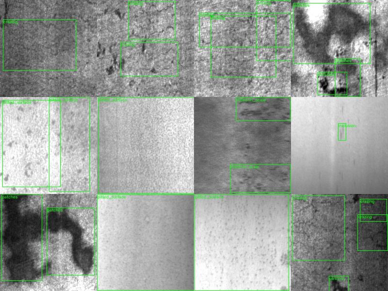
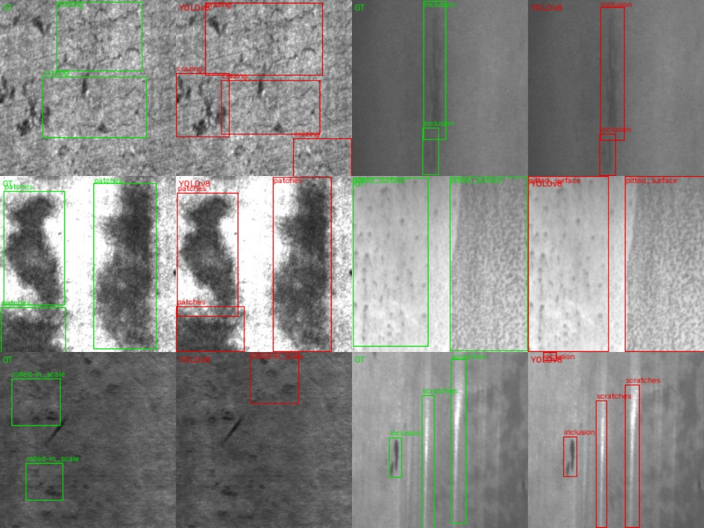
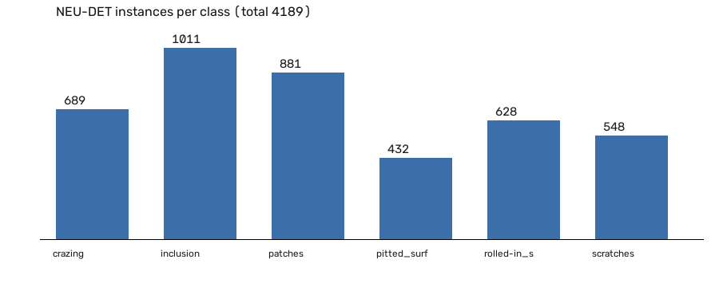
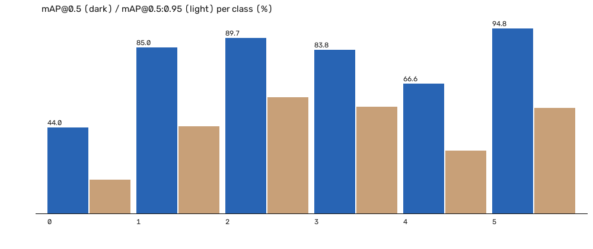
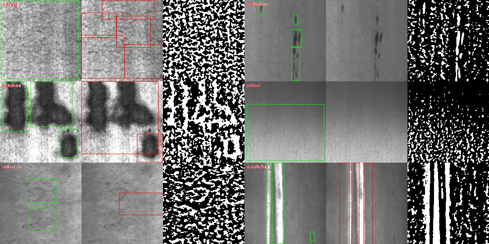
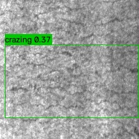

# 工业表面缺陷检测：YOLOv8 + OpenCV + ONNX（NEU-DET）

工业视觉求职项目：在公开钢材表面缺陷数据集 **NEU-DET** 上跑通「数据准备 → YOLOv8 训练/评估 → ONNX 导出部署」完整流程，
并实现一个 **OpenCV 传统视觉基线**做定量对比，说明为什么这类任务需要深度学习。

- 数据集：NEU-DET（东北大学公开数据集，6 类钢材表面缺陷，1800 张 200×200 灰度图）
- 主模型：YOLOv8n，验证集 **mAP@0.5 = {{y8n_map50}}**，mAP@0.5:0.95 = {{y8n_map50_95}}（P = {{y8n_p}}，R = {{y8n_r}}）
- 部署：ONNX opset 12 + onnxruntime **CPU 单张推理 {{onnx_ms}} ms**（P95 {{onnx_p95}} ms，端到端 {{e2e_ms}} ms），
  并在 **Linux（Debian 容器）复现**，检测结果与 Windows 一致（Linux 纯推理 {{onnx_linux_ms}} ms）
- 传统视觉基线：验证集 F1 = {{ocv_f1}}、误检 {{ocv_fp}} 个/图、单图 {{ocv_ms}} ms —— 远低于 YOLO，量化说明传统方法的局限

> 本仓库只使用公开数据集与自产数据，**不包含任何公司内部数据、截图或代码**。

---

## 1. 结果速览

{{runs_table}}

说明：
- 主模型 YOLOv8n 训练 100 epoch（640×640、batch 16、AMP，RTX 4060 Laptop 8GB），最佳 epoch {{y8n_best_epoch}}；
- 增强消融：关闭 Mosaic/HSV/翻转后，模型在第 {{noaug_best_epoch}} epoch 就达到峰值 mAP@0.5 = {{noaug_best_mAP50}}，
  随后过拟合回落（第 60 epoch 末仅 {{noaug_last_mAP50}}）；默认增强最终 mAP@0.5 = {{y8n_map50}}（{{aug_gain}}）。
- 同 epoch 口径（第 60 epoch）：默认增强 {{aug60_map50}} vs 关闭增强 {{noaug60_map50}}，对比方向一致。

### 每类指标（YOLOv8n，验证集 360 张 / 863 个框）

{{per_class_table}}

## 2. 数据集：NEU-DET

| 项目 | 数值 |
| --- | --- |
| 图像总数 | {{ds_images}}（6 类 × 300 张） |
| 标注框总数 | {{ds_boxes}} |
| 划分 | train {{ds_train}} / val {{ds_val}}（按类别分层，固定 seed=42） |
| 多标签图像 | {{ds_multi_class_imgs}} 张（一张图可同时含多类缺陷，非错标） |
| 内容重复图像组 | {{ds_dup_groups}} 组（划分时同组强制同 split，避免泄漏） |

数据来源：东北大学 NEU Surface Defect Database（Kechen Song, Yunhui Yan）。本仓库不重新分发数据集，
下载后按下面的目录放置即可复现。

```
data/raw/NEU-DET/
  train/images/<class>/*.jpg        # class: crazing, inclusion, patches,
  train/annotations/*.xml           #        pitted_surface, rolled-in_scale, scratches
  validation/...                    # 镜像自带的 split 会被忽略，脚本会重新分层划分
```

`scripts/prepare_neu_det.py` 负责：
1. VOC XML → YOLO txt（归一化 `cls xc yc w h`，越界框裁剪、退化框丢弃并计数）；
2. **按类别分层 + 固定 seed 重新划分**（不沿用镜像 split），MD5 相同的图像分到同一侧；
3. 输出 `reports/dataset_analysis.json`（每类数量/实例数、框面积分布、重复图、多标签图）；
4. `scripts/verify_labels.py` 再做一遍标签质量校验（越界/过小/重复框/类别一致），当前 **0 个硬错误**。

## 3. 环境安装

Windows 11 + Python 3.12，实测 RTX 4060 Laptop 8GB / CUDA 12.4：

```powershell
python -m venv .venv
.venv\Scripts\python.exe -m pip install -U pip
.venv\Scripts\pip.exe install torch==2.6.0+cu124 torchvision==0.21.0+cu124 --index-url https://download.pytorch.org/whl/cu124
.venv\Scripts\pip.exe install -r requirements.txt
```

CPU 环境把 torch 换成 `--index-url https://download.pytorch.org/whl/cpu` 即可，其余流程不变（训练会慢很多）。

## 4. 复现命令

```powershell
# 0) 数据准备 + 标签校验
python scripts/prepare_neu_det.py
python scripts/verify_labels.py

# 1) 训练（默认增强 / 关闭增强 / 更大模型）
python scripts/train.py --model yolov8n.pt --epochs 100 --name y8n_aug
python scripts/train.py --model yolov8n.pt --epochs 60  --name y8n_noaug --aug none
python scripts/train.py --model yolov8s.pt --epochs 60  --name y8s_aug

# 2) 评估（整体 + 每类 AP + 混淆矩阵/PR 曲线）
python scripts/eval_yolo.py --weights runs/detect/y8n_aug/weights/best.pt --name y8n_aug

# 3) ONNX 导出 + 延迟测试 + 与 PyTorch 交叉验证
python scripts/export_onnx.py --weights runs/detect/y8n_aug/weights/best.pt --name y8n_aug_onnx
python scripts/onnx_infer.py --model models/y8n_aug_onnx.onnx --weights runs/detect/y8n_aug/weights/best.pt --bench --runs 100

# 4) OpenCV 传统视觉基线（网格搜索 + 验证集评估）
python scripts/opencv_baseline.py --yolo-eval reports/eval_y8n_aug.json

# 5) README 图表
python scripts/make_figures.py --weights runs/detect/y8n_aug/weights/best.pt
```

一键脚本：`.\scripts\run_all.ps1`。

## 5. 训练与消融

| 实验 | 目的 | 设置 |
| --- | --- | --- |
| `y8n_aug` | 主模型 | YOLOv8n，100 epoch，默认增强（Mosaic/HSV/翻转/缩放） |
| `y8n_noaug` | 增强消融 | YOLOv8n，60 epoch，关闭全部增强 |

固定项：`imgsz=640`、`batch=16`、`seed=42`、`deterministic=True`、`patience=0`、AMP 开启。
200×200 原图上采样到 640 输入；训练曲线、混淆矩阵、PR 曲线在 `runs/detect/<name>/`。

> 可选实验：YOLOv8s 容量对比（`python scripts/train.py --model yolov8s.pt --epochs 30 --name y8s_aug`）。
> 本机 16 GB 内存下该实验训练到第 11 epoch 被系统内存压力终止，因此**未纳入结论**；
> 脚本本身支持在内存更大的机器上复现，仓库不提交未完成的数字。

**关于类别不均衡**：NEU-DET 每类图像数相同（300 张），但实例数不均衡（432–1011 个框，比例约 1:2.3）。
本项目没有伪造"重采样"数字，而是（1）逐类统计并报告 AP/召回差异，（2）用 Mosaic/HSV/翻转等增强缓解小样本过拟合，
（3）在 `reports/` 中定位难类（inclusion、pitted_surface）。

## 6. ONNX 导出与部署

```powershell
python scripts/export_onnx.py --weights runs/detect/y8n_aug/weights/best.pt --name y8n_aug_onnx
```

- 导出设置：`opset=12`、`simplify=True`、`dynamic=False`、`batch=1`；
- ultralytics 导出的图 **不含 NMS**：输出 `(1, 4+nc, 8400)` 的 xywh（输入像素坐标）+ sigmoid 后的类别分数，
  因此 `scripts/onnx_infer.py` 自己实现 letterbox 预处理、输出解码、类别感知 NMS、坐标反变换回原图；
- 部署验证：与 PyTorch 推理在 8 张验证图上逐框比对（同类 + IoU≥0.95），结果一致（`all_agree = true`）；
- 延迟：onnxruntime CPU，warmup 10 次后跑 100 次，纯 `session.run` 均值 {{onnx_ms}} ms（P95 {{onnx_p95}} ms），
  含预处理/后处理端到端 {{e2e_ms}} ms；模型大小 {{onnx_size_mb}} MB；
- **Linux 环境复现**：在 Debian 13 容器（`docker run ... bash scripts/validate_linux.sh`）中安装 onnxruntime CPU 版重跑，
  检测结果与 Windows 完全一致，Linux 下纯推理 {{onnx_linux_ms}} ms、端到端 {{onnx_linux_e2e_ms}} ms（容器/WSL2 开销导致略慢）。

> 局限：这里测的是本机 CPU 延迟，不是产线工控机/GPU 的实时性；batch=1 单张，未做 INT8 量化或 TensorRT。

## 7. OpenCV 传统视觉基线（与 YOLO 对比）

`scripts/opencv_baseline.py` 实现无学习的缺陷候选提取：

```
灰度 → CLAHE → GaussianBlur → 缺陷响应（Otsu 反二值 / black-hat / 自适应阈值）
     → 形态学开闭 → findContours → 外接矩形 + 面积/长宽比筛选
```

- 参数在 **训练集子集（60 张）** 上做 624 组网格搜索（IoU≥0.3 匹配、F1 最优），**不碰验证集**；
- 选定参数后在验证集评估（传统方法无类别头，匹配是类别无关的）：

| 方法 | Precision | Recall | F1 | 误检/图 | 单图耗时 |
| --- | --- | --- | --- | --- | --- |
| OpenCV 传统视觉 | {{ocv_p}} | {{ocv_r}} | {{ocv_f1}} | {{ocv_fp}} | {{ocv_ms}} ms |
| YOLOv8n | {{y8n_p}} | {{y8n_r}} | — | — | — |

每类召回率（传统视觉）：

{{ocv_table}}

结论：传统方法在纹理型缺陷（crazing/patches）上还能抓到一部分，但对低对比度、细纹理缺陷（inclusion、pitted_surface）
召回很低——固定阈值 + 形态学无法适配多类缺陷的尺度/对比度差异，这是本项目采用 YOLO 的直接依据。

## 8. 相机标定

```powershell
python scripts/make_chessboard.py                 # A4 9x6 内角点、18mm 方格
python scripts/camera_calibration.py --square 18  # 读取 assets/calib_photos/*.jpg
```

- `findChessboardCornersSB` + `cornerSubPix` 提角点，`calibrateCamera`（张正友标定法）求内参/畸变；
- 输出 `reports/camera_calibration.json`（内参矩阵、畸变系数、每视角/整体重投影误差）与去畸变前后对比图；
- `--synthetic` 模式用渲染的已知相机图像做代码自测（RMS 0.076 px，焦距反推误差 0.25%），
  **仅用于验证代码路径，不作为真实相机标定结果**。

> 真实相机标定需要打印棋盘格拍 12–15 张照片，照片放在 `assets/calib_photos/`（见该目录 README）。

## 9. 可视化

| 数据集与标注 | 训练预测 vs 标注 |
| --- | --- |
|  |  |

| 每类标注框数量 | 每类 AP |
| --- | --- |
|  |  |

| 传统视觉 vs 标注（左：GT，中：传统视觉候选，右：二值化掩膜） | ONNX 推理结果 |
| --- | --- |
|  |  |

## 10. 项目结构

```
scripts/
  prepare_neu_det.py     VOC→YOLO、分层划分、数据统计分析
  verify_labels.py       标签质量校验（越界/过小/重复/类别一致）
  train.py               训练封装（可复现参数、增强消融、结果摘要）
  eval_yolo.py           整体/每类 AP、混淆矩阵、PR 曲线、每类 AP 柱状图
  export_onnx.py         ONNX 导出 + 输入输出形状校验
  onnx_infer.py          letterbox/解码/NMS + 延迟基准 + 与 PyTorch 交叉验证
  opencv_baseline.py     传统视觉基线（网格搜索 + 验证集评估 + 对比图）
  camera_calibration.py  棋盘格标定（真实照片 / 合成自测）
  make_chessboard.py     生成可打印 A4 棋盘格
  make_figures.py        README 图表
  collect_metrics.py     汇总所有实测指标 → 简历/README
  validate_linux.sh      Linux（容器/CI）中的 ONNX 推理验证脚本
.github/workflows/
  onnx-linux.yml         Ubuntu runner 上自动跑 ONNX 推理与延迟基准
reports/                 指标 JSON/Markdown（真实运行产物）
screenshots/             数据集、预测对比、传统视觉对比等图
models/
  y8n_aug_onnx.onnx      导出的 ONNX 模型（提交进仓库，审阅者可直接推理）
```

## 11. 局限与诚实的说明

1. 划分是**随机分层划分**，未按钢板/母卷分组，同一母卷的图像可能同时出现在 train/val，指标可能偏高；
2. 数据集只有 1800 张、类别/纹理相似度高，模型换产线/换光照需要重新标注与微调；
3. ONNX 延迟是单机 CPU 结果，不代表工控机实时性；未做量化/TensorRT；
4. 传统视觉基线是"能跑通、可量化"的对照，不是工业级算法；
5. 相机标定的真实重投影误差需用实拍照片复现，仓库里只有代码自测结果。

## 12. 参考

- NEU-DET: Song K., Yan Y. *A noise robust method based on completed local binary patterns for hot-rolled steel strip surface defects*, Applied Surface Science, 2013.
- Ultralytics YOLOv8: https://github.com/ultralytics/ultralytics
- OpenCV camera calibration: https://docs.opencv.org/4.x/dc/dbb/tutorial_py_calibration.html
